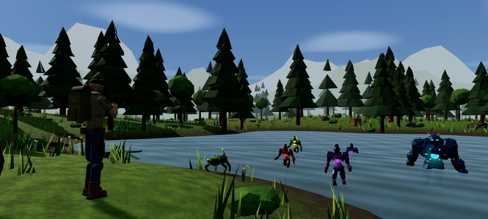

# Alien Survival 3D

A third-person, real-time 3D endless alien survival shooter for Android. It is
built with Flutter (app shell, menus, progression, storage) and a three.js /
WebGL 2 engine (all gameplay rendering) running on an Android WebView surface.



## Architecture

```
Flutter (lib/)                                Engine (engine_src/ → assets/game/game.js)
─────────────────────────────                 ───────────────────────────────────────────
Splash · Menu · Loadout · Shop · Upgrades     three.js renderer (shadows, fog, tone mapping)
Settings · Stats · High scores                Streamed procedural forest + collision world
GameScreen ─ WebView ──────── http://127.0.0.1 (loopback AssetServer)
           ─ JS channel "GameBridge" ◄─────── send(type, data)  (ready, paused, gameOver, …)
           ─ runJavaScript ─────────────────► window.game.boot(config) / pause / resume /
                                               restart / setSettings / quit
SaveRepository (shared_preferences)           Skinned soldier & aliens, anim state machine + IK
GameState (economy, upgrades → config)        Weapons, AI, waves, traps, pickups, FX, WebAudio
```

**Why this design:** Flutter's own rendering (Canvas/Flame) is 2D, and Flutter GPU /
flutter_scene are still experimental. A mature WebGL engine gives real 3D:
perspective camera, depth buffer, skeletal skinning, shadow maps, GPU
particles and HRTF positional audio. It runs on every Android 7+ device with
an up-to-date System WebView. Flutter stays the application framework. The
engine is bundled offline and served from a loopback-only HTTP server. The app
makes no internet connections, shows no ads and has no analytics. The INTERNET
permission is needed only to open the loopback socket.

## Features

- **Third-person camera:** over-the-shoulder view with drag-to-look, sensitivity and FOV settings, shoulder swap, collision against terrain and obstacles, aim zoom, sniper scope, recoil kick and trauma shake.
- **Soldier:** camera-relative analog movement, sprint, crouch, jump/land, combat roll with i-frames and water wading. A layered animation state machine with two-bone IK keeps the hands on the weapon.
- **Weapons:** assault rifle, shotgun (9 pellets), sniper (scope, armour-piercing, penetration), SMG, pistol (infinite reserve) and minigun (spin-up). Each has its own magazine, reserve, fire rate, damage falloff, spread, recoil, reload time, sound and muzzle flash. Grenades are physical bouncing projectiles.
- **Aliens (9 types):** purple grunt, red stalker (dodges your aim, charges), blue brute (bullet-resistant, ground-shockwave slam you can jump over), green crawler (ambush spawns, zig-zag lunges), acid spitter (keeps range, arcing acid, damaging puddles), bloater (self-destructs), sky wraith (flies, dive attacks), void elite (dashes) and the Hive Titan boss (smash, 12 m slam, acid volley, charge, summons escorts). A finite-state-machine AI runs on top of flow-field pathfinding, with separation and stuck recovery.
- **Endless waves:** escalating composition and stats, a boss every 5th wave, a bounded number of live aliens per quality preset, and off-screen reachable spawn points (cave mouths act as hives). Also includes a combo multiplier, score, wave bonus and drop tables.
- **World:** infinite chunk-streamed terrain with dirt paths, streams, ponds, bridges, watchtowers, glowing caves, clearings and distant mountains. Explosive barrels chain-react, landmines arm and detonate, spike traps, breakable crates, and barricades and logs give cover.
- **HUD:** soldier portrait (rendered from the model), red health and blue armour bars, weapon icon, ammo, grenades, wave / kills / timer / score / combo, coins and gems, radar, crosshair with dynamic spread, hit/headshot/kill markers, damage-direction ring, boss bar, kill feed and pickup toasts.
- **Touch controls:** virtual joystick (dead zone, push past the rim to sprint) and fire, aim, reload, jump, crouch, roll, grenade, switch, sprint and contextual interact buttons. Multi-touch is supported, and the fire button also acts as a look pad. Size, opacity and placement are configurable via a drag-to-place layout editor. Keyboard and mouse work for desktop testing (WASD, mouse drag, F/Z/R/Space/C/V/G/Q/E, L for pointer lock).
- **Audio:** music, effects and ambience buses with separate volumes, 3D positional sound, voice limiting and a compressor. Includes forest/wind/water ambience, birds, footsteps by surface, and combat/boss/menu/game-over music.
- **Progression:** coins from kills, pickups and run bonuses, and gems from elites and bosses. Weapon unlocks; per-weapon damage, magazine and reload upgrades; soldier health, armour and grenade upgrades; high scores (top 10) and lifetime statistics including kills per alien type.
- **Performance:** LOW / MEDIUM / HIGH presets plus a 30/60 FPS cap. Vegetation is instanced, with LOD and frustum culling. Enemies, particles, tracers, decals, projectiles and pickups are pooled. Far aliens animate at a reduced rate. Resolution adapts automatically when FPS drops.

## Building

Requirements: Flutter 3.47+ (Dart 3.13), Android SDK (API 36 platform and build tools via Android Studio), JDK 17+.

```bash
cd alien_survival_3d
flutter pub get
flutter run --release          # device connected
flutter build apk --release    # build/app/outputs/flutter-apk/app-release.apk
```

The release build is signed with the debug key. Configure your own keystore in
`android/app/build.gradle.kts` before publishing.

CI: `.github/workflows/alien-survival-apk.yml` rebuilds the engine, runs
`flutter analyze` and `flutter test`, builds the release APK and uploads it as
the `alien-survival-3d-apk` artifact.

### Rebuilding generated content (optional; outputs are committed)

```bash
# 3D engine bundle (assets/game/game.js)
cd engine_src && npm ci && npm run build

# all sound effects and music (needs numpy, scipy, ffmpeg with libvorbis)
python3 tool/gen_audio.py

# UI images rendered from the 3D models (needs Playwright + Chromium and a
# static server on :8765 serving this folder, e.g. `npx http-server -p 8765 .`)
node engine_src/dev/render_ui_assets.mjs
```

### Playing the engine in a desktop browser

Serve this folder (`npx http-server -p 8765 .`) and open
`http://127.0.0.1:8765/assets/game/index.html?quality=HIGH&fps=1`.

## Project layout

```
lib/
  main.dart            orientation, immersive mode
  app/                 app, routes/transitions, theme (#D1FE17)
  engine/              asset_server.dart (loopback), game_bridge.dart (WebView + events)
  progression/         catalog.dart (weapons, upgrade costs), game_state.dart (economy)
  storage/             models.dart (validated JSON), save_repository.dart (backup/recovery)
  audio/               menu_audio.dart
  ui/                  widgets.dart, screens/*
engine_src/src/
  main.js              Game: boot, loop, bridge API, debug API
  core/                config (weapons, aliens, quality), math/noise, bridge
  render/              textures, geometry builder, sky, model snapshots
  world/               terrain, foliage, props, collision world, chunk streaming
  actors/              skeleton/skinning, models, animation + IK
  game/                player, camera, combat, enemies, flow field, director, pickups, traps, projectiles
  fx/                  GPU particles, effects
  audio/               WebAudio engine
  ui/                  HUD, controls, icons
assets/game/           index.html (HUD CSS), game.js (built), audio/*.ogg
assets/images/         menu/soldier/alien/weapon renders
tool/gen_audio.py      sound synthesis
test/                  Flutter unit + widget tests
engine_src/dev/        Playwright scenarios (smoke, combat, controls, systems, host contract, phone)
docs/                  ASSET_MANIFEST.md, TESTING.md
```
